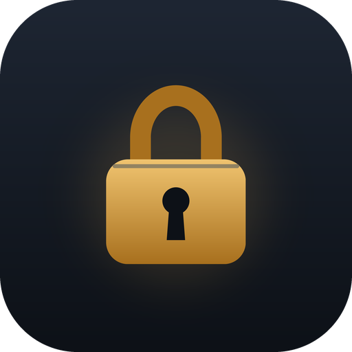
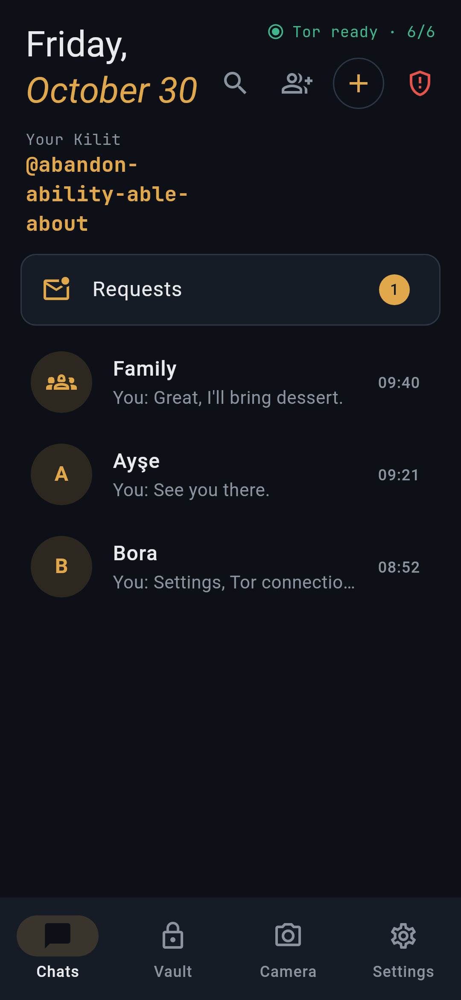
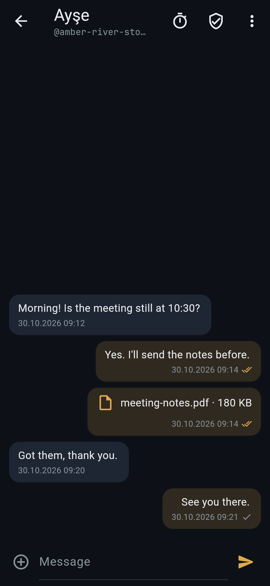
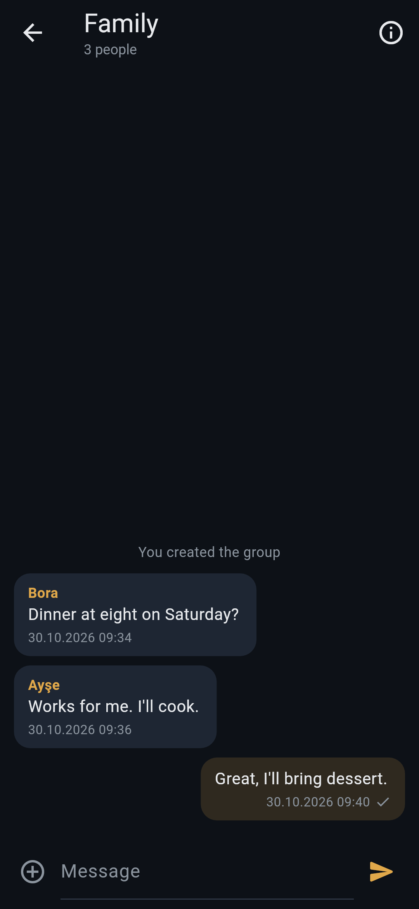
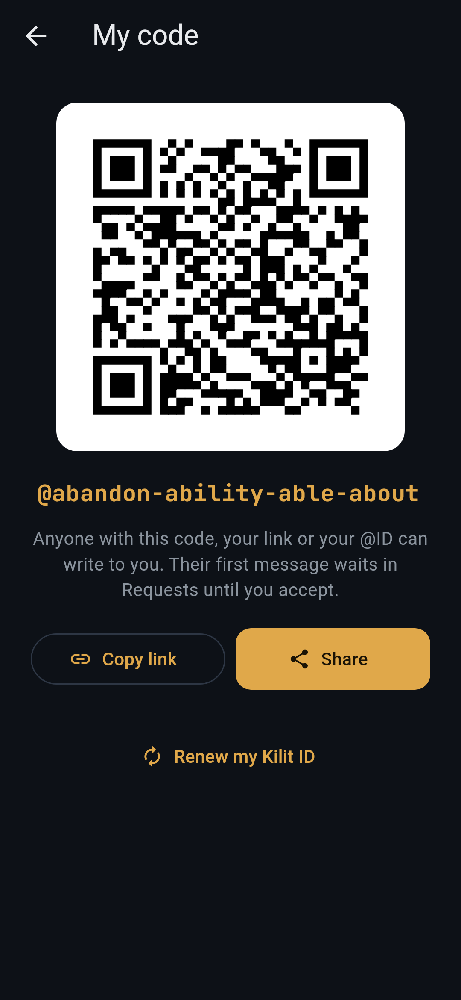
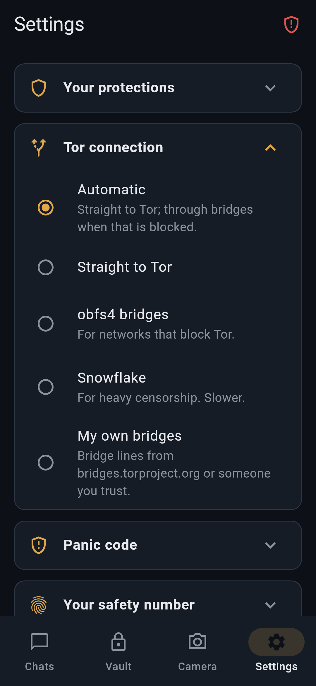
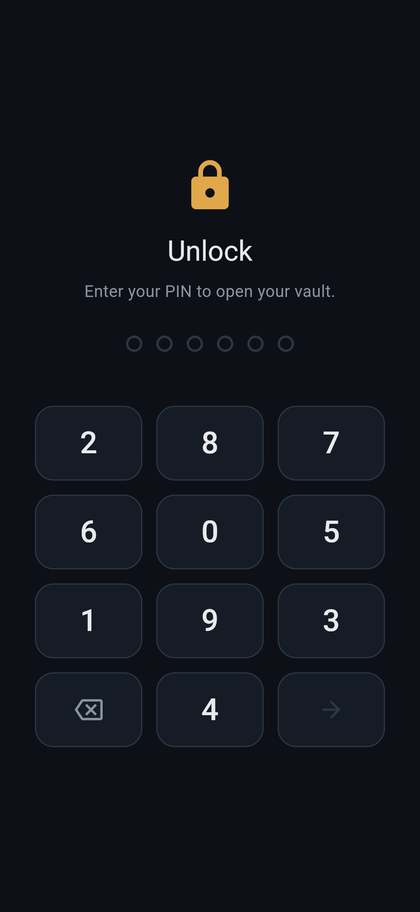

<p align="center">
  
</p>

<h1 align="center">Kilit</h1>

<p align="center">
  <b>Gizli bir mesajlaşma uygulaması ve şifreli kasa.</b><br>
  Hesap, telefon numarası ve sunucu yok. Kuantum sonrası Signal protokolü, yalnızca Tor üzerinden.
</p>

<p align="center">
  <a href="https://github.com/smyrna-pergamum/kilit-messenger/releases"></a>
  <a href="https://github.com/smyrna-pergamum/kilit-messenger/actions/workflows/ci.yml"></a>
  <a href="LICENSE"></a>
  
</p>

<p align="center">
  <a href="https://github.com/smyrna-pergamum/kilit-messenger/releases"><b>APK'yı indir</b></a>
  ·
  <a href="README.md">English</a>
</p>

Hesap, telefon numarası ve kendi sunucusu olmayan bir mesajlaşma uygulaması
ve şifreli dosya kasası. Mesajlar Signal protokolünün kuantum sonrası
sürümüyle uçtan uca şifrelenir ve telefondan yalnızca Tor üzerinden, açık
Nostr relay'lerine çıkar.

<p align="center">
  
  
  
  
</p>
<p align="center">
  
  
</p>
<p align="center"><sub>Kişiler ve mesajlar uydurmadır. Kilit telefonda ekran görüntüsü alınmasını engellediği için bu görüntüler gerçek ekranlardan <code>app/tool/screenshots</code> ile çizilir.</sub></p>

> **Alfa sürüm, denetlenmedi.** Kilit bağımsız bir güvenlik denetiminden
> geçmedi. Hayatınızın ya da özgürlüğünüzün bağlı olduğu durumlarda
> kullanmayın.

## Neler yapar

**Sohbetler**
- Kayıt yok. Kilit kimliğiniz dört kelimeden oluşur, örneğin
  `@abandon-ability-able-about`. Kimliğinizi QR kodu ya da `kilit://add?…`
  bağlantısı olarak paylaşırsınız; bağlantı doğrudan Kilit'i açar.
- Mesajlar [libsignal](https://github.com/signalapp/libsignal) ile
  şifrelenir: ilk temasta Kyber1024'lü PQXDH, sonrasında kuantum sonrası
  mandal (SPQR).
- Size ilk yazan yabancılar **İstekler**'e düşer ve bunun için küçük bir iş
  kanıtı (proof of work) ödemeleri gerekir. Siz kabul edene kadar onlara
  okundu bilgisi gitmez.
- Teslim tikleri: tek tik mesajın bir relay'de durduğunu, çift tik karşı
  telefonun mesajı açtığını gösterir. Teslim edilemeyen mesaj bir hafta
  boyunca günde bir kez yeniden gönderilir. Tike dokunarak hemen yeniden de
  gönderebilirsiniz.
- 5 MB'a kadar fotoğraf ve dosya. Her dosya kendi anahtarıyla şifrelenir.
  Resimlerin üst verisi (konum, kamera bilgisi) gönderilmeden önce silinir.
  Kamera fotoğrafları bellekte çekilir, diske hiç yazılmaz.
- Süreli mesajlar, her sohbet için ayrı ayarlanır.
- En fazla 20 kişilik gruplar. Her mesaj her üyeye ayrı ayrı şifrelenir; bu
  yüzden relay'de bir grup mesajı sıradan bir mesajdan ayırt edilemez.
  Grubu kuran kişi grubun yöneticisidir.
- Kimliğinizi yenileyebilirsiniz: yeni kelimeler alırsınız, eski kimlik ve
  bağlantı çalışmaz olur, kişileriniz ise kalır.

**Ağ**
- Kilit'in içinde Tor gömülüdür ve kendi sunucusu yoktur. Mesajlar açık
  Nostr relay'lerinde, her gün değişen posta kutusu etiketleri altında
  bekler.
- Tor'un engellendiği yerlerde Kilit köprüler kullanabilir: yerleşik obfs4
  ya da Snowflake köprüleri, veya sizin eklediğiniz köprü satırları.
  Otomatik modda önce doğrudan bağlanmayı, sonra obfs4'ü, sonra Snowflake'i
  dener.

**Kasa**
- Notlar ve dosyalar için şifreli bir kasa (`.klt` biçimi; age üzerine
  kurulu, hibrit kuantum sonrası X-Wing anahtarlarıyla).
- Taşıyıcı modu: bir mesajı `KLT1:` metni olarak mühürleyip herhangi bir
  başka mesajlaşma uygulamasıyla gönderebilirsiniz.
- PIN, telefonun donanım anahtarına (StrongBox ya da TEE) bağlıdır. Bu
  yüzden uygulama verisinin bir kopyası başka bir cihazda denenemez.
- Panik kodu: ayrı bir 4 haneli kod her şeyi siler ve Kilit'i ilk kurulum
  hâline döndürür.

**Ayrıca:** 15 dil. Analitik, çökme raporu ve reklam yoktur.

## Kurulum

APK'yı [Releases](https://github.com/smyrna-pergamum/kilit-messenger/releases)
sayfasından indirin. Android 7.0 ve sonrasında çalışır. Kilit iki izin
ister: yalnızca gömülü Tor'un kullandığı ağ izni ve sohbette çektiğiniz
fotoğraflar için kamera.

Kurmadan önce iki şeyi denetleyin:

1. Dosyanın SHA-256 özeti, sürüm notlarındakiyle aynı olmalı.
2. İmza sertifikası Kilit'in sertifikası olmalı:

   ```
   SHA-256: DE:B8:42:2C:53:F6:FB:C3:34:7C:5C:0B:84:31:61:17:D2:C9:4A:53:CD:70:FA:6A:B4:E9:50:16:DA:9D:B1:E1
   ```

   Sertifikayı `apksigner verify --print-certs Kilit-*.apk` komutuyla
   görebilirsiniz.

Windows sürümü henüz yok.

## Nasıl çalışır

| Belge | İçerik |
| --- | --- |
| [spec/KILIT-NET.md](spec/KILIT-NET.md) | Ağ protokolü: kimlikler, kartlar, posta kutuları, alındı bildirimleri, dosyalar, gruplar |
| [spec/KLT1.md](spec/KLT1.md) | `.klt` kasa ve taşıyıcı biçimi |
| [THREAT_MODEL.md](THREAT_MODEL.md) | Kilit neye karşı korur, neye karşı korumaz |
| [PRIVACY.md](PRIVACY.md) | Ne toplanır (hiçbir şey) ve relay'ler ne görür |
| [docs/RELAYS.md](docs/RELAYS.md) | Kilit'in kullandığı relay'ler |

## Yapı

| Klasör | İçerik |
| --- | --- |
| `core/` | Rust çekirdeği: kasa, mesajlaşma, ağ, dosya ayrıştırma; her bölme ayrı bir crate |
| `app/` | Flutter uygulaması (Android; Windows sonra) |
| `engine-tor/` | Android için gömülü Tor ve köprü taşıyıcıları (Go) |
| `spec/` | Protokol ve dosya biçimi tanımları |
| `repro/` | Sürümleri sabitlenmiş, tekrarlanabilir derleme konteynerleri |
| `docs/` | Derleme, relay listesi |

## Derleme

[docs/BUILDING.md](docs/BUILDING.md) dosyasına bakın. Her şey sürümleri
sabitlenmiş Docker imajlarında derlenir:

```bash
./repro/build.sh test
```

## Güvenlik

Güvenlik açıklarını herkese açık bir issue olarak değil, bu reponun
**Security → Report a vulnerability** sayfasından özel olarak bildirin.
Ayrıntılar [SECURITY.md](SECURITY.md) dosyasında.

## Lisans

GPL-3.0-or-later. Kilit kısmen [Kryfo](https://github.com/GnosiWorks/Kryfo)
projesinden (GPL-3.0-or-later) türetilmiştir. libsignal'a (AGPL-3.0)
bağlandığı için birleşik program AGPL-3.0'ın ağ üzerinden etkileşim
koşullarını taşır. Tüm üçüncü taraf bileşenler [NOTICE](NOTICE) dosyasında
listelidir. Kilit, Kryfo değildir ve Kryfo'nun yazarları tarafından
desteklenmemektedir.
